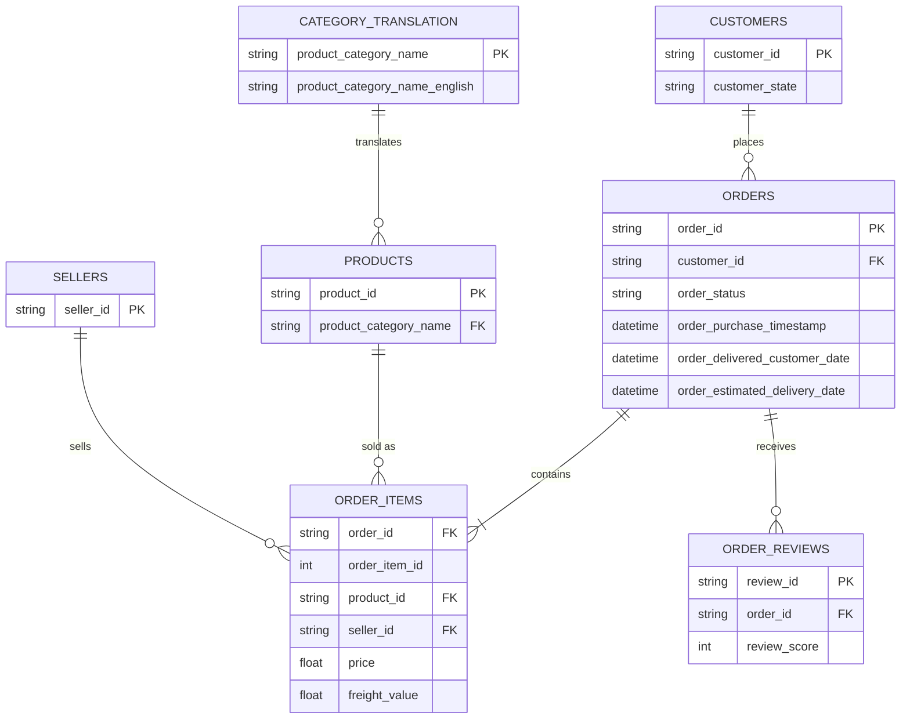

# Where Should a New Brand Sell? A Category Opportunity Scan of Brazil's Olist Marketplace

> Status: analysis complete, dashboard in progress

## Goal

A brand wants to start selling on Olist, one of Brazil's largest e-commerce marketplaces. Which product category should it enter?

This project treats that question as a client brief. Instead of building a general dashboard, every analysis feeds one decision: which category gives a new brand the best chance to win, and what risks it should plan for.

## Who this is for

| As a...                        | I want to...                                       | So that I can...                                    | Answered by                        |
| ------------------------------ | -------------------------------------------------- | --------------------------------------------------- | ---------------------------------- |
| Brand category manager         | compare categories on size, growth and competition | choose the category with the best chance of success | Category scorecard                 |
| E-commerce marketing manager   | see which categories surge during Black Friday     | plan stock and campaigns for the next mega sale     | Black Friday analysis              |
| Marketplace operations manager | find where late deliveries lower review scores     | prioritise which regions to fix first               | Delivery analysis                  |
| Pricing analyst                | see the typical price point in each category       | set a competitive launch price                      | Category scorecard (average price) |

## Dataset

[Brazilian E-Commerce Public Dataset by Olist](https://www.kaggle.com/datasets/olistbr/brazilian-ecommerce) (Kaggle)

- About 100,000 real, anonymised orders placed on Olist between 2016 and 2018
- 9 related tables covering orders, items, products, sellers, customers, payments, reviews and geolocation
- Raw data is not stored in this repo. Download it from Kaggle and place the CSVs in `data/`.

### Tables used



Payments and geolocation are not needed for this question and are left out.

## Approach

### 1. Clean and join (Python, pandas)

`notebooks/clean_data.ipynb`

- Join orders, items, products, category names, customers and reviews into one table at **order item level** (one row per item sold)
- Keep only delivered orders placed between January 2017 and August 2018, the period with complete monthly data
- Translate category names to English
- Calculate delivery days and a late delivery flag (delivered after the estimated date)
- Average the score for the few orders that have more than one review
- Export `excel/olist_clean.csv`

### 2. Prepare the data (Excel)

`excel/olist_analysis.xlsx`

- Import with Power Query, keeping ID columns as text so Excel does not convert them to scientific notation
- Load as an Excel Table (`Orders`) and add calculated columns:
  - `late_flag` (IF): 1 if delivered late, otherwise 0
  - `delivery_band` (nested IF): under 7 days, 7 to 14 days, over 14 days
  - `price_band` (nested IF): under R$50, R$50 to 150, R$150 and above
  - `region` (SWITCH): maps Brazil's 27 states into its 5 official regions
- Count orders with `UNIQUE`, because the data is at item level and one order can contain several items

### 3. Category scorecard

27 categories with at least 500 items sold are compared side by side. The threshold stops small categories from ranking high on growth by chance.

**Growth is measured as market share change, not raw growth.** Total marketplace GMV grew about 137% between Jan to Aug 2017 and Jan to Aug 2018, so almost every category grew. A category that grew slower than the marketplace was actually losing ground. Share change (in percentage points) shows who is really winning.

Each factor is converted to a 0 to 1 score with `PERCENTRANK`, so factors on different scales can be compared, then combined with weights:

| Factor        | Measure                                             | Weight |
| ------------- | --------------------------------------------------- | ------ |
| Size          | Total GMV                                           | 30%    |
| Momentum      | Market share change (pp)                            | 30%    |
| Openness      | 1 minus the top 3 sellers' share of GMV             | 25%    |
| Customer pain | Lower average review = more room for a better brand | 15%    |

Average price is shown for context but not scored, because whether a high price is good depends on the brand.

Formulas used: `LET`, `FILTER`, `UNIQUE`, `SORT`, `SUMIFS`, `AVERAGEIFS`, `MAP` and `LAMBDA` (distinct sellers and top 3 seller share per category), `PERCENTRANK.INC`, `RANK.EQ`, `TAKE`, `SORTBY`, plus a conditional formatting heat map.

### 4. Delivery and customer satisfaction

PivotTables comparing average review score by delivery time band and by late vs on time, and late delivery rate by region.

### 5. Black Friday 2017

- Monthly GMV and late delivery rate (PivotTable with a two-axis chart)
- Category comparison of October vs November 2017, ranked by **extra GMV** rather than percentage uplift, so categories with very small October sales do not top the list

### 6. Dashboard (in progress)

One-page summary with KPI tiles and four charts telling the story in order: where to sell, when demand peaks, what risk to manage, and where that risk is.

## Key findings

**Marketplace overview (Jan 2017 to Aug 2018)**

- 96,211 delivered orders, R$13.2M GMV, from 2,945 sellers
- Average order value R$137; 7.9% of deliveries arrived late; average review 4.08

**Category opportunity**

- Top 3 categories by score: **health_beauty (0.87)**, **housewares (0.82)** and **watches_gifts (0.75)**
- Biggest share gains: watches_gifts (+3.3 pp), health_beauty (+2.8 pp), construction_tools_construction (+1.8 pp)
- Biggest share losses: cool_stuff (−4.1 pp), garden_tools and perfumery (−1.8 pp), toys (−1.7 pp)
- office_furniture is highly concentrated (top 3 sellers hold 83%) and has the lowest average review (3.52)

**Delivery and reviews**

- Orders delivered in under 7 days average 4.34 stars; orders taking over 14 days average 3.59
- 27% of items took more than two weeks to arrive
- Late orders average **2.55 stars vs 4.21** for on-time orders, a gap of 1.66 stars
- The Northeast has the highest late rate (14.2%), about twice the South (6.9%)

**Black Friday 2017**

- November 2017 GMV was 52% higher than October
- The late delivery rate rose from 5.1% in October to 13.8% in November
- Most extra Black Friday GMV went to bed_bath_table, health_beauty, furniture_decor, watches_gifts and toys
- Late deliveries also spiked in February and March 2018 (15.7% and 20.5%) without a matching sales jump; the cause needs further investigation

## Recommendation

Coming soon.

## Limitations

- Review score and late rate are averaged per item, so orders with several items count more than once. The effect on the averages is small.
- The data covers one marketplace in one country between 2017 and 2018, so results describe Olist at that time, not the whole Brazilian market.
- Category weights in the scorecard are a judgement call. Changing them is a quick way to test how stable the ranking is.

## Repository structure

```
olist-ecommerce-analysis/
├── data/                    # raw Olist CSVs (not committed)
├── notebooks/
│   └── 01_clean_join.ipynb  # cleaning and joining
├── excel/
│   ├── olist_clean.csv      # cleaned item-level table
│   └── olist_analysis.xlsx  # Overview, Scorecard, Delivery, Black Friday and Dashboard sheets
└── README.md
```

## Tools

Python (pandas), Jupyter, Microsoft Excel (Power Query, Tables, dynamic array formulas, PivotTables, PivotCharts, conditional formatting), Git and GitHub
