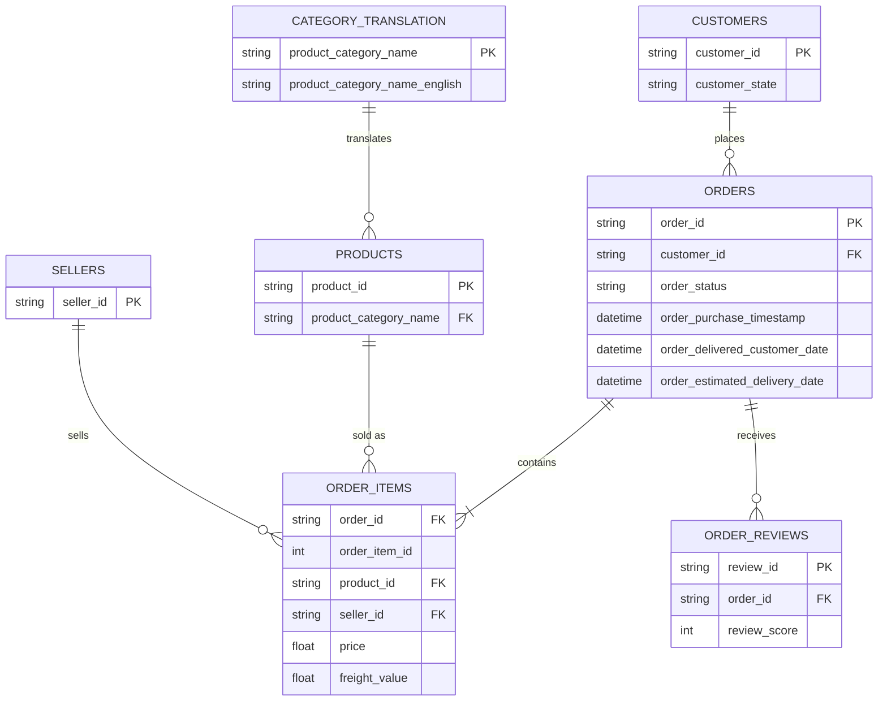

# Where Should a New Brand Sell? A Category Opportunity Scan of Brazil's Olist Marketplace

> Status: in progress

## Goal

A brand wants to start selling on Olist, one of Brazil's largest e-commerce marketplaces. Which product category should it enter?

This project treats that question as a client brief. Instead of building a general dashboard, every analysis feeds one decision: which category gives a new brand the best chance to win.

Each category is scored on five factors:

| Factor        | What is measured                                      | Why it matters                                                     |
| ------------- | ----------------------------------------------------- | ------------------------------------------------------------------ |
| Market size   | Total GMV (sum of item prices, excluding freight)     | Is the market big enough to be worth entering?                     |
| Growth        | GMV Jan to Aug 2018 vs Jan to Aug 2017                | Is demand growing or shrinking?                                    |
| Competition   | Number of sellers and the top 3 sellers' share of GMV | Is the category dominated by a few sellers, or open to a newcomer? |
| Customer pain | Average review score and % of late deliveries         | Low satisfaction is a gap a better brand can fill                  |
| Price point   | Average price and price band mix                      | Does the category suit a premium or a budget brand?                |

A bonus analysis looks at Black Friday 2017: which categories surged and how delivery performance held up, similar to how brands prepare for 11.11 and 12.12 mega sales in Southeast Asia.

## Dataset

[Brazilian E-Commerce Public Dataset by Olist](https://www.kaggle.com/datasets/olistbr/brazilian-ecommerce) (Kaggle)

- About 100,000 real, anonymised orders placed on Olist between 2016 and 2018
- 9 related tables covering orders, items, products, sellers, customers, payments, reviews and geolocation
- Raw data is not stored in this repo. Download it from Kaggle and place the CSVs in `data/`.

## Who this is for

| As a...                        | I want to...                                       | So that I can...                                     | Answered by                 |
| ------------------------------ | -------------------------------------------------- | ---------------------------------------------------- | --------------------------- |
| Brand category manager         | compare categories on size, growth and competition | choose the category with the best chance of success  | Category scorecard          |
| E-commerce marketing manager   | see which categories surge during Black Friday     | plan stock and campaigns for the next mega sale      | Black Friday analysis       |
| Marketplace operations manager | find where late deliveries lower review scores     | prioritise which categories and regions to fix first | Delivery vs review analysis |
| Pricing analyst                | see which price bands sell best in each category   | set a competitive launch price                       | Price band analysis         |

### Tables used



Payments and geolocation are not needed for this question and are left out.

## Approach

**1. Clean and join (Python, pandas)**
`notebooks/clean_data.ipynb`

- Join orders, items, products, category names, customers and reviews into one table at **order item level** (one row per item sold)
- Keep only delivered orders placed between January 2017 and August 2018, the period with complete monthly data
- Translate category names to English
- Calculate delivery days and a late delivery flag (delivered after the estimated date)
- Average the score for the few orders that have more than one review
- Export `excel/olist_clean.csv`

**2. Analyse (Excel)**
`excel/olist_analysis.xlsx`

- Import with Power Query, keeping ID columns as text so they are not converted to scientific notation
- Calculated columns with IF, IFS and SWITCH: late flag, delivery time bands, price bands, and customer region
- PivotTables for each factor, using distinct count of `order_id` for order numbers because the data is at item level
- Category scorecard with conditional formatting, limited to categories with at least 500 items sold so small categories do not win on growth by chance
- Overview dashboard with KPIs (total orders, GMV, % late, average review) and slicers for month and region

**3. Recommend**

Shortlist three categories from the scorecard and recommend one, with the reasoning a brand manager would need.

## Repository structure

```
olist-ecommerce-analysis/
├── data/                    # raw Olist CSVs (not committed)
├── notebooks/
│   └── 01_clean_join.ipynb  # cleaning and joining
├── excel/
│   ├── olist_clean.csv      # cleaned item-level table
│   └── olist_analysis.xlsx  # analysis, scorecard and dashboard
└── README.md
```

## Results

Coming soon.

## Tools

Python (pandas), Jupyter, Microsoft Excel (Power Query, Tables, PivotTables, slicers, conditional formatting), Git and GitHub
