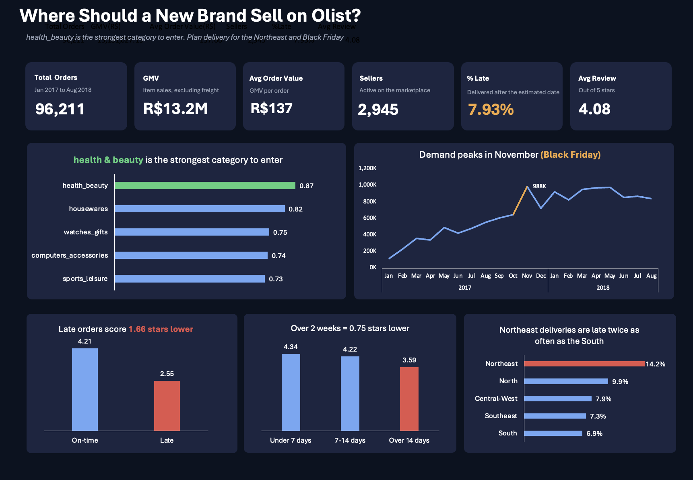
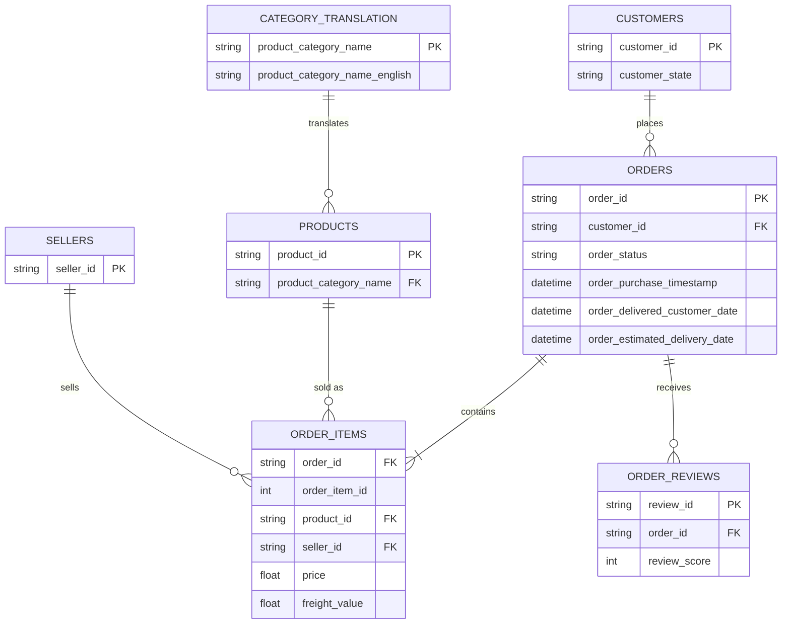

# Where Should a New Brand Sell? A Category Opportunity Scan of Brazil's Olist Marketplace

## Goal

Imagine a brand that wants to start selling on Olist, one of Brazil's largest online marketplaces. Which product category should it choose?

I treated this question like a real client brief. Instead of making many unrelated charts, every part of the analysis helps answer one decision: which category gives a new brand the best chance to succeed, and what risks it should prepare for.

## Who this is for

| As a...                        | I want to...                                       | So that I can...                                    | Answered by                        |
| ------------------------------ | -------------------------------------------------- | --------------------------------------------------- | ---------------------------------- |
| Brand category manager         | compare categories by size, growth and competition | choose the category with the best chance of success | Category scorecard                 |
| E-commerce marketing manager   | see which categories grow during Black Friday      | plan stock and campaigns for the next big sale      | Black Friday analysis              |
| Marketplace operations manager | find where late deliveries lower review scores     | decide which regions to improve first               | Delivery analysis                  |
| Pricing analyst                | see the typical price in each category             | set a competitive launch price                      | Category scorecard (average price) |

## Dataset

[Brazilian E-Commerce Public Dataset by Olist](https://www.kaggle.com/datasets/olistbr/brazilian-ecommerce) (Kaggle)

- About 100,000 real, anonymised orders from Olist between 2016 and 2018
- 9 connected tables: orders, items, products, sellers, customers, payments, reviews and geolocation
- The raw data is not included in this repo. To run the project, download it from Kaggle and put the CSV files in `data/`.

### Tables used

I did not use the payments and geolocation tables because they are not needed for this question.

## Approach

### 1. Clean and join the data (Python, pandas)

`notebooks/clean_data.ipynb`

- Joined six tables into one table where **each row is one item sold**
- Kept only delivered orders from January 2017 to August 2018, because these months have complete data
- Translated category names into English
- Calculated delivery days and a late delivery flag (delivered after the estimated date)
- Averaged the review score for the few orders with more than one review
- Exported the result to `excel/olist_clean.csv`

### 2. Prepare the data in Excel

`excel/olist_analysis.xlsx`

- Imported the CSV with Power Query and kept the ID columns as text, so Excel did not change them into scientific notation
- Loaded the data as an Excel Table called `Orders` and added new columns:
  - `late_flag` (IF): 1 if the order was late, otherwise 0
  - `delivery_band` (nested IF): under 7 days, 7 to 14 days, over 14 days
  - `price_band` (nested IF): under R$50, R$50 to 150, R$150 and above
  - `region` (SWITCH): groups Brazil's 27 states into its 5 official regions
- Counted orders with `UNIQUE`, because one order can contain several items

### 3. Category scorecard

I compared 27 categories that sold at least 500 items. This limit stops very small categories from ranking high just because they grew from a tiny starting point.

**I measured growth as a change in market share, not as raw growth.** The whole marketplace grew by about 137% between Jan to Aug 2017 and Jan to Aug 2018, so nearly every category grew. A category that grew more slowly than the marketplace was actually losing its position. Market share change shows which categories were really winning.

Each factor was turned into a score from 0 to 1 using `PERCENTRANK`, so that factors with different units could be compared fairly. The scores were then combined with these weights:

| Factor        | Measure                                                 | Weight |
| ------------- | ------------------------------------------------------- | ------ |
| Size          | Total GMV                                               | 30%    |
| Momentum      | Change in market share (percentage points)              | 30%    |
| Openness      | 1 minus the top 3 sellers' share of GMV                 | 25%    |
| Customer pain | Lower average review means more room for a better brand | 15%    |

Average price is shown for context but not scored, because a high price can be good or bad depending on the brand.

Main formulas: `LET`, `FILTER`, `UNIQUE`, `SORT`, `SUMIFS`, `AVERAGEIFS`, `MAP` and `LAMBDA` (to count sellers and calculate the top 3 seller share for each category), `PERCENTRANK.INC`, `RANK.EQ`, `TAKE` and `SORTBY`, with a conditional formatting heat map.

### 4. Delivery and customer satisfaction

PivotTables comparing the average review score by delivery time and by late vs on-time orders, and the late delivery rate by region.

### 5. Black Friday 2017

- Monthly GMV and late delivery rate (PivotTable and chart)
- A comparison of October and November 2017 for each category, ranked by **extra GMV** instead of percentage growth, so categories with very small October sales do not appear at the top

### 6. Dashboard

A one-page dashboard in a dark theme with six KPI cards and five charts. The KPI cards are linked to the Overview sheet, so they update automatically. Each chart title states the main insight, and colour is used with meaning: blue for normal values, red for problems, green for the recommended category and amber for warnings.

## Key findings

**Marketplace overview (Jan 2017 to Aug 2018)**

- 96,211 delivered orders, R$13.2M in GMV, from 2,945 sellers
- Average order value of R$137, 7.9% of deliveries were late, and the average review was 4.08 out of 5

**Category opportunity**

- The top 3 categories by score were **health_beauty (0.87)**, **housewares (0.82)** and **watches_gifts (0.75)**
- The biggest market share gains were watches_gifts (+3.3 pp), health_beauty (+2.8 pp) and construction_tools_construction (+1.8 pp)
- The biggest losses were cool_stuff (−4.1 pp), garden_tools and perfumery (−1.8 pp) and toys (−1.7 pp)
- office_furniture is controlled by a few sellers (the top 3 hold 83% of sales) and has the lowest average review (3.52)

**Delivery and reviews**

- Orders delivered in under 7 days received 4.34 stars on average, while orders that took more than 14 days received 3.59
- 27% of items took more than two weeks to arrive
- Late orders received **2.55 stars compared with 4.21** for on-time orders, a difference of 1.66 stars
- The Northeast had the highest late delivery rate (14.2%), about twice as high as the South (6.9%)

**Black Friday 2017**

- GMV in November 2017 was 52% higher than in October
- The late delivery rate rose from 5.1% in October to 13.8% in November
- Most of the extra Black Friday sales went to bed_bath_table, health_beauty, furniture_decor, watches_gifts and toys
- Late deliveries also increased in February and March 2018 (15.7% and 20.5%), even though sales did not jump. The reason for this needs more investigation.

## Recommendation

**A new brand should enter health_beauty.**

It is the largest category (R$1.23M in GMV), it gained 2.8 percentage points of market share, and no single seller controls it, as the top 3 sellers hold only 18% of sales across 475 sellers. It was also one of the main winners during Black Friday, which makes it a good category for campaign planning.

The main risk is delivery. Health_beauty has a slightly higher late rate (9.1%) than the marketplace average (7.9%), and late orders lose 1.66 stars on average. Before growing, the brand should:

- prepare extra stock and delivery capacity before Black Friday, when late deliveries almost tripled
- consider a fulfilment partner or stock closer to the Northeast, where deliveries are late most often

Other options depend on the type of brand:

- **housewares** for a brand that wants the most open category (the top 3 sellers hold only 12%)
- **watches_gifts** for a premium brand, because it has the fastest share growth and a high average price (R$199)

## Limitations

- Review scores and late rates are averaged per item, so orders with several items are counted more than once. This has only a small effect on the results.
- The data comes from one marketplace in one country between 2017 and 2018, so the results describe Olist at that time, not the whole Brazilian market.
- The scorecard weights are based on my judgement. Changing them is an easy way to test how stable the ranking is.
